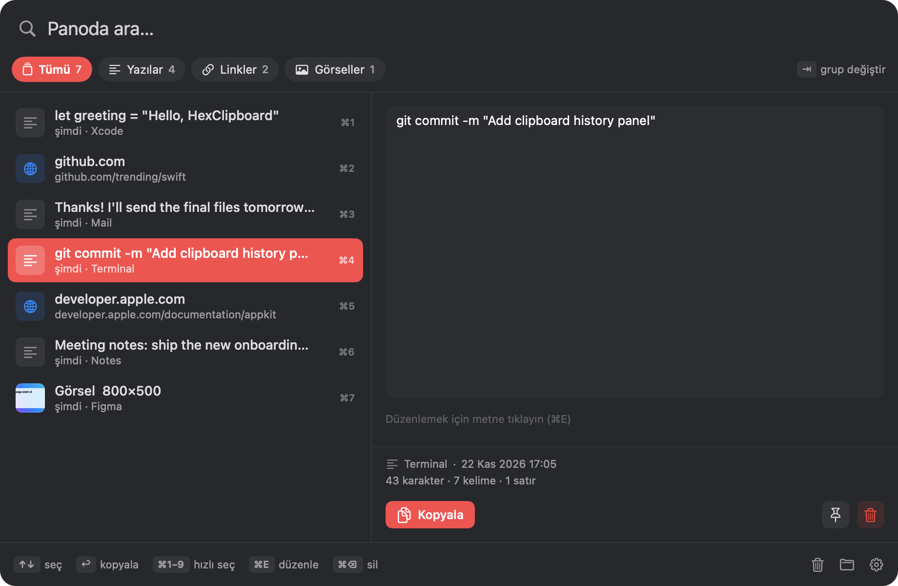

# HexClipboard

A fully local **clipboard history** app for the macOS menu bar. It keeps the text, links and images you copy and brings them back with a single shortcut.



## How to install & open
Requires macOS 14+ on an Apple Silicon Mac (M1 or later).

1. **[⬇ Download HexClipboard.dmg](https://github.com/Huseyinkayaw/HexClipboard/raw/main/release/HexClipboard.dmg)**
2. Open the DMG and drag **HexClipboard** into the **Applications** folder.
3. Open HexClipboard. Because the app is free and not notarized by Apple, macOS shows *"HexClipboard" Not Opened — Apple could not verify…*. Click **Done**.
4. Open **System Settings → Privacy & Security**, scroll down to *"HexClipboard" was blocked…* and click **Open Anyway**, then enter your Mac password. You only need to do this once.
5. When asked, allow **Accessibility** (for direct paste) in System Settings → Privacy & Security.

Prefer Terminal? Steps 3–4 can be replaced with:

```bash
xattr -dr com.apple.quarantine /Applications/HexClipboard.app
```

SHA-256 of the DMG: `99f4ca746146563219d11d50ffb008c328c821733758eaec07a454c74854e35e`

## Features
- History for text, links and images — copy anywhere with ⌘C and it shows up here
- Open shortcut (default **⌃⌘V**, configurable in Settings)
- Paste the selected item straight into the app you're working in with `↩`; quick pick with `⌘1…9`
- Pin items, keep pinned items when clearing, pause recording
- Drag-and-drop shelf
- Ignores content copied from password managers
- Data is stored only in `~/Documents/HexClipboard`

## Privacy & security
- Makes no network connections.
- History is stored only on this Mac in `~/Documents/HexClipboard` (readable only by your user account), excluded from Spotlight and iCloud sync. It is not encrypted, so pause recording before copying sensitive text if needed.
- Skips anything copied from password managers (concealed/transient clipboard types).
- Opens only `http`, `https` and `mailto` links.

## Build from source
Requirements: macOS 14+, Apple Silicon, Xcode Command Line Tools.

```bash
./build.sh               # build and install to /Applications
./build.sh --no-install  # build only (build/)
./build.sh --dmg         # create dist/HexClipboard.dmg
```
On first launch it asks for **Accessibility** permission (needed for direct paste).

---

## Türkçe

macOS menü çubuğunda çalışan, tamamen yerel bir **pano geçmişi** uygulaması. Kopyaladığınız yazıları, linkleri ve görselleri saklar; tek kısayolla geri getirip yapıştırmanızı sağlar.

**Kurulum ve ilk açılış** (macOS 14+, Apple Silicon / M1 ve üstü)

1. **[⬇ HexClipboard.dmg dosyasını indirin](https://github.com/Huseyinkayaw/HexClipboard/raw/main/release/HexClipboard.dmg)**
2. DMG'yi açın ve **HexClipboard**'i **Uygulamalar** klasörüne sürükleyin.
3. HexClipboard'i açın. Uygulama ücretsiz olduğu ve Apple tarafından onaylanmadığı için macOS *"HexClipboard" Açılmadı — Apple … doğrulayamadı* uyarısı gösterir. **Bitti**'ye basın.
4. **Sistem Ayarları → Gizlilik ve Güvenlik**'i açın, aşağı inip *"HexClipboard" engellendi* satırındaki **Yine de Aç**'a tıklayın ve Mac şifrenizi girin. Bu yalnızca bir kez yapılır.
5. İstendiğinde Sistem Ayarları → Gizlilik ve Güvenlik'ten **Erişilebilirlik** (doğrudan yapıştırma için) izni verin.

Terminal kullanıyorsanız 3–4. adımların yerine: `xattr -dr com.apple.quarantine /Applications/HexClipboard.app`

DMG SHA-256: `99f4ca746146563219d11d50ffb008c328c821733758eaec07a454c74854e35e`

**Özellikler**
- Yazı, link ve görsel geçmişi — herhangi bir yerde ⌘C yapın, burada görünür
- Açma kısayolu (varsayılan **⌃⌘V**, ayarlardan değiştirilebilir)
- `↩` ile seçilen öğeyi çalıştığınız uygulamaya doğrudan yapıştırma, `⌘1…9` ile hızlı seçim
- Öğeleri sabitleme, temizlerken sabitlenenleri koruma, kaydı duraklatma
- Sürükle-bırak paneli
- Parola yöneticilerinden kopyalananları kaydetmez
- Veriler yalnızca `~/Documents/HexClipboard` klasöründe durur

**Gizlilik ve güvenlik**
- İnternete bağlanmaz.
- Geçmiş yalnızca bu Mac'te, `~/Documents/HexClipboard` klasöründe durur (yalnızca sizin kullanıcınız okuyabilir); Spotlight ve iCloud eşitlemesi dışında tutulur. Şifrelenmez; hassas bir şey kopyalayacaksanız kaydı duraklatabilirsiniz.
- Parola yöneticilerinden kopyalananları kaydetmez.
- Yalnızca `http`, `https` ve `mailto` linklerini açar.

**Kaynaktan derleme:** macOS 14+, Apple Silicon ve Xcode Command Line Tools gerekir. `./build.sh` derler ve `/Applications`'a kurar; `--no-install` yalnızca derler, `--dmg` kurulum dosyası üretir. İlk açılışta doğrudan yapıştırma için **Erişilebilirlik** izni istenir.
